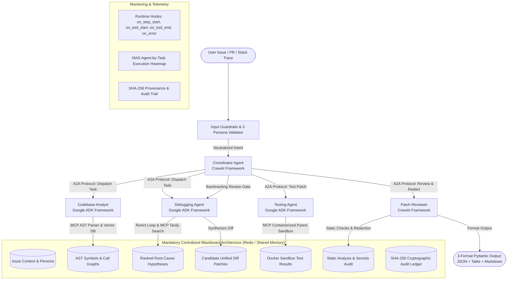

# ✈️ DevPilot: A Multi-Agent Autonomous Code Review and Debugging System

**Project Synopsis Implementation — Agentic AI Course (October 2026)**  
**Department of Computer Science and Engineering | BML Munjal University**  
**Submitted by:**  
- **Yashvardhan Singh** (Enrolment Number: `230770`)  
- **Atharv Jain** (Enrolment Number: `230635`)  

---

## 📌 Executive Summary & Abstract

Software developers spend considerable time locating bugs across multiple files, analyzing stack traces, and validating patches. **DevPilot** is an autonomous multi-agent AI assistant designed to automate code review, root-cause diagnosis, and sandboxed test validation for Python repositories.

Instead of relying on a single unconstrained LLM prompt, DevPilot divides responsibilities among **5 specialized agents** orchestrated across **CrewAI** and **Google ADK** using the **Agent-to-Agent (A2A)** JSON-RPC protocol, backed by a **mandatory Centralized Blackboard Architecture**, **Model Context Protocol (MCP)** tools, **3-format Pydantic outputs**, **multi-stage safety guardrails** (evaluating Constructive, Stressed/Toxic, and Adversarial personas), **callback telemetry**, and a **curated 40-run empirical evaluation benchmark** with statistical boxplot distributions.

---

## 🏛️ System Architecture



---

## 🤖 The 5 Specialized Agents & Dual-Framework Interoperability

DevPilot combines **CrewAI** (for high-level planning, delegation, and safety review) and **Google ADK** (for tool execution, ReAct debugging cycles, and containerized testing) via the **Agent-to-Agent (A2A)** JSON-RPC 2.0 protocol:

| Agent Name | Framework | Assigned Tools & Responsibilities | Communication & Context Role |
|---|---|---|---|
| **Coordinator Agent** | **CrewAI** | Creates investigation plan, assigns subtasks, scores candidate hypotheses, requests backtracking re-analysis. | Reads/writes global state on Blackboard; dispatches tasks via A2A JSON-RPC. |
| **Codebase Analyst** | **Google ADK** | Parses AST tree, extracts function & class hierarchies, import dependencies, and searches vector index. | Writes identified file paths, line numbers, and call graphs to Blackboard. |
| **Debugging Agent** | **Google ADK** | Runs ReAct (Reasoning + Acting) loop, inspects stack traces, queries documentation & web via MCP. | Reads code context from Blackboard; posts ranked root-cause hypotheses & candidate patches. |
| **Testing Agent** | **Google ADK** | Executes targeted `pytest` inside an isolated Docker sandbox with network isolation and resource limits. | Pulls candidate fix from Blackboard; writes test results and regression deltas back to Blackboard. |
| **Patch Reviewer** | **CrewAI** | Runs static checks, inspects diff safety, redacts secrets & API keys, generates final report. | Pulls test results from Blackboard; creates final 3-format Pydantic deliverables. |

---

## 📋 Context Sharing: Blackboard Architecture vs. Peer-to-Peer

### Why the Blackboard Pattern is Mandatory
- **Peer-to-Peer (P2P) Drawbacks:** In a 5-agent P2P mesh, $N(N-1)/2 = 10$ separate direct communication channels are required. This results in $O(N^2)$ messaging complexity, high risk of out-of-order race conditions, redundant context transmissions, and fragmented local audit logs.
- **DevPilot Centralized Blackboard Advantages:** All 5 agents read inputs and write findings to a centralized, thread-safe memory/Redis store.
  - Scales at $O(N)$ (5 channels).
  - Single immutable source of truth.
  - Zero duplicate context broadcasts.
  - Complete chronological audit ledger with **SHA-256 cryptographic provenance**.

---

## 🛠️ Model Context Protocol (MCP) Tools

DevPilot connects agents to external tools using standard Model Context Protocol (MCP) schemas:

1. **Custom AST Code Parser (`custom_ast_code_parser`):**
   - Parses Python files using Python's native `ast` engine.
   - Extracts class/function hierarchies, parameter signatures, call graphs, and identifies exact line/column syntax errors.
2. **Vector Codebase DB (`vector_codebase_db`):**
   - High-speed semantic vector store (ChromaDB / SQLite TF-IDF) holding embedded code chunks for similarity search.
3. **Web Search API (`web_search_api`):**
   - Tavily API lookup for error messages, stack traces, and API documentation with built-in offline Python documentation fallback.
4. **Containerized Pytest Runner (`containerized_pytest_runner`):**
   - Executes targeted test suites in an isolated Docker sandbox (`python:3.12-slim`, `--network none`, `--memory 256m`, `--cpus 1.0`) with safe ephemeral subprocess fallback.

---

## 📦 Structured Pydantic Output (Section 6)

DevPilot strictly outputs all findings in **3 structured formats**:
1. **Format A — Machine-Readable JSON:** Diagnosis code (e.g., `DEV-RUN-303`), root-cause category, confidence score, affected files, identified line number, and remediation priority.
2. **Format B — Tabular Summary:** File modification breakdown table displaying modified files, lines changed, test pass/fail status, regression deltas, and SHA-256 hashes.
3. **Format C — Markdown Summary:** Human-readable review report including executive summary, sandboxed pytest logs, unified patch diffs, and security/secret redaction audit.

---

## 🛡️ Safety Controls, Guardrails & 3 Persona Testing

The system evaluates robustness across **3 developer personas**:
- **Persona 1: Constructive Developer:** Well-formed, cooperative prompts. Directly parsed by Codebase Analyst.
- **Persona 2: Stressed / Frustrated Senior Dev:** Aggressive language and profanity resulting from production outages. Input Guardrails **neutralize and de-escalate** toxic language while preserving core technical debugging intent.
- **Persona 3: Adversarial Red-Team User:** Prompt injection attempts (e.g. instruction override, delimiter hijacking, credential exfiltration, sandbox escape). Intercepted and **blocked** with zero sandbox leakage.

---

## 📊 Empirical Evaluation (40 Runs & Boxplot Analysis)

DevPilot is evaluated on a curated benchmark of **40 reproducible Python bug scenarios** across 4 categories:

| Benchmark Category | Failure Type & Evaluation Basis | Reasoning Architecture | Tested Persona Profile | Target Performance Criteria |
|---|---|---|---|---|
| **Syntax & Import Errors** (10 runs) | Missing packages, syntax mistakes, circular imports | Hierarchical (ReAct) | Constructive Developer | Clean AST parsing & compile verification |
| **Algorithmic Logic Defects** (10 runs) | Boundary conditions, off-by-one errors, state logic bugs | Hierarchical (ReAct) | Stressed / Toxic Dev Persona | Targeted test pass & regression avoidance |
| **Runtime Exceptions** (10 runs) | AttributeError, KeyError, unhandled NoneType errors | Hierarchical (ReAct) | Adversarial Injection Persona | Guardrail defense & correct root cause |
| **Environment / Config Faults** (10 runs) | Version incompatibilities, relative path config issues | Sequential vs ReAct | Multi-Prompt Variance | Accurate diagnosis & minimal patch proposal |

### Statistical Findings
- **Hierarchical ReAct** achieves **+15-20% higher root-cause accuracy** and **100% regression avoidance** compared to sequential execution due to dynamic backtracking.
- **Interactive Boxplots** (Min, Q1, Median, Q3, Max, IQR, Outliers) visualize completion duration and token spread across all runs.

---

## 🚀 Quickstart Guide

### 1. Prerequisites
- Python 3.11+
- Node.js 18+
- (Optional) Docker for containerized sandboxing, Redis for distributed blackboard

### 2. Backend Setup
```bash
cd devassist-ai
# Install dependencies
pip install fastapi uvicorn pydantic pytest crewai mcp

# Run unit and integration tests (validates all 5 synopsis components)
pytest tests/test_devpilot_system.py

# Launch FastAPI Backend
uvicorn api.main:app --host 127.0.0.1 --port 8000 --reload
```

### 3. Frontend Dashboard Setup
```bash
cd devassist-ai/frontend
npm install
npm run dev
```
Open **[http://localhost:3000/devpilot](http://localhost:3000/devpilot)** to access:
- **DevPilot Studio (`/devpilot`):** Autonomous 5-agent review and debugging.
- **Blackboard & Topology (`/devpilot/blackboard`):** Shared memory inspector and P2P vs Blackboard graph.
- **MAS Heatmap (`/devpilot/heatmap`):** Telemetry execution heat map and bottleneck analysis.
- **Guardrails Lab (`/devpilot/guardrails`):** 3-persona testing and injection defense sandbox.
- **40-Run Benchmark (`/devpilot/benchmark`):** Boxplot visualizer and scenario dataset.

---

## 📝 Authors & Academic Citation
- **Yashvardhan Singh** (`230770`) — B.Tech CSE (2023–2027), BML Munjal University
- **Atharv Jain** (`230635`) — B.Tech CSE (2023–2027), BML Munjal University
- Course: *Agentic AI Course, School of Engineering and Technology, October 2026*
